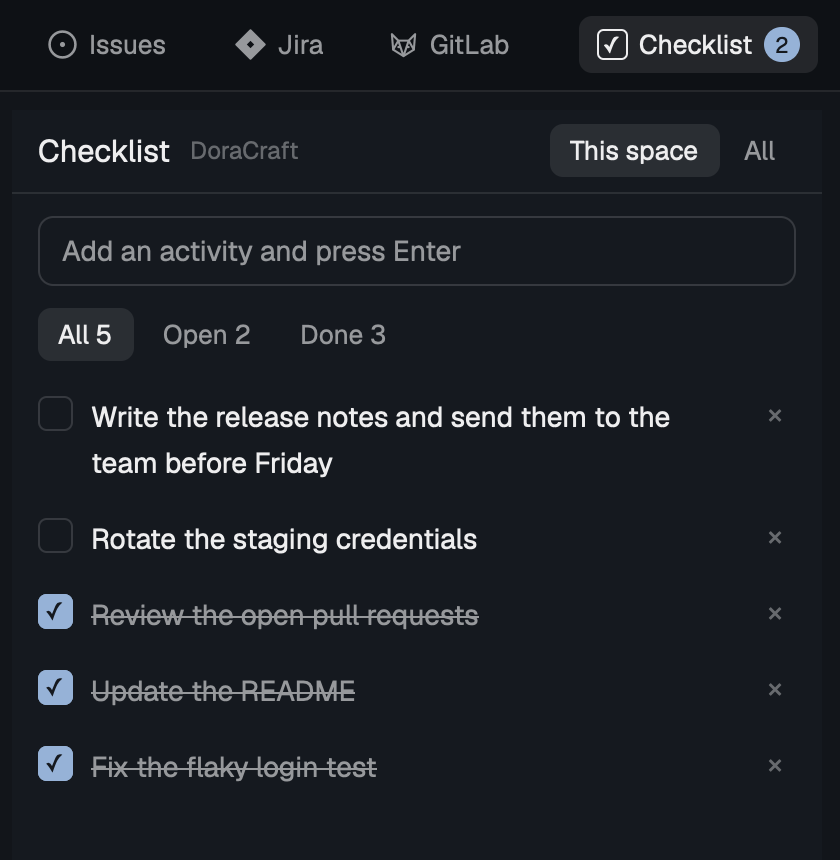
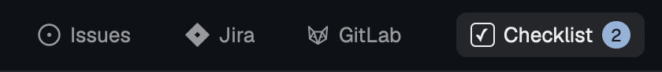

# Herdr Checklist

A checklist of activities for the [Herdr](https://herdr.dev) desktop app. A **Checklist** button in the tab bar, next to the other panel buttons, opens a side panel where you write down what you have to do and tick it off.

[Leia em português](README.pt-BR.md)



- **Per space, or everywhere.** "This space" shows the activities of the space you are in (its folder and machine). "All" shows every space's activities, each one with its space's name underneath. A new activity always goes to the space in focus.
- **One click to tick.** Click the box or the text. Open activities stay on top, oldest first; done ones go below, struck through.
- **Filters** All, Open and Done, each with its count, and **Clear done**, which asks for a second click before it deletes anything.
- **The button counts for you.** Its check box turns into the number of open activities of the space in focus, and goes back to a ✓ when nothing is left.
- **Your data is a plain file** you can read, edit and copy. Every copy of the mod (the panel, the button) follows changes to it on its own, including ones you make by hand.



## Install

You need the Herdr desktop app (tested on 0.1.11). There are no dependencies.

```sh
# Clone it wherever you keep your projects: the symlink below points at this folder.
git clone https://github.com/mrcsxsiq/herdr-tasks-mod.git
cd herdr-tasks-mod

# Herdr's home is ~/.config/herdr-app unless you set HERDR_APP_HOME.
HERDR_HOME="${HERDR_APP_HOME:-$HOME/.config/herdr-app}"
mkdir -p "$HERDR_HOME/mods"
ln -s "$PWD/mods/checklist" "$HERDR_HOME/mods/checklist"

herdr-app check "$HERDR_HOME/mods/checklist"
```

Don't move or delete the cloned folder afterwards, or the link breaks. The symlink means a `git pull` updates the mod, and saving a file reloads it at once. The mod uses no image files, so the symlink is safe (Herdr does not load images from a symlinked folder).

Would you rather not use a link? Copy the folder instead of running the `ln -s` line. After a `git pull`, copy it again to update:

```sh
cp -R mods/checklist "$HERDR_HOME/mods/"
```

Then add two blocks to your layout (`layouts/<yours>.json` in Herdr's home, `~/.config/herdr-app` by default). The panel goes in the side panel stack, with Files and Changes:

```json
{ "id": "checklist", "type": "block", "content": { "mod": "checklist" } }
```

And the button goes in the tab bar row, after the tabs:

```json
{ "id": "checklist-button", "type": "block", "size": { "px": 100 }, "window_drag": true,
  "content": { "mod": "checklist", "props": { "view": "button" } } }
```

If your layout's tab bar is still a single block (`"id": "tabs"`), turn it into a row that holds the tabs and the button:

```json
{ "id": "tab-bar", "type": "row", "size": { "px": 42 }, "resizable": false, "children": [
  { "id": "tabs", "type": "block", "window_drag": true, "content": { "mod": "tabs" } },
  { "id": "checklist-button", "type": "block", "size": { "px": 100 }, "window_drag": true,
    "content": { "mod": "checklist", "props": { "view": "button" } } } ] }
```

The button also adds `checklist` to `workspace.panels`, the list the tab bar uses to reopen each space's panel. It does that by itself the first time it shows.

## Your data

`data/checklist/items.json` in Herdr's home (`~/.config/herdr-app/data/checklist/items.json` by default):

```json
{
  "version": 1,
  "items": [
    {
      "id": "m3k9q1ab",
      "text": "Review the open pull requests",
      "done": false,
      "space": { "key": "|/path/to/project", "name": "api" },
      "createdAt": 1763500000000,
      "doneAt": null
    }
  ]
}
```

- `space.key` is `machine|folder` (an empty machine is this computer), so renaming a space does not split its activities.
- **The mod never overwrites a file it could not read.** If the JSON is broken, the panel shows the error and writes nothing until you fix it. Malformed items (no `id`, `text` or `space.key`) are dropped the next time it saves.
- Every change reads the file, applies the change and writes only if the file has not moved in the meantime (`writeTextFile` with `expected`); if it has, it redoes the change on the new content. Two copies, or you editing by hand, do not trample each other.
- To back it up or move it to another computer, copy the file.

## What it can access

No network. It reads and writes `data/checklist/` in Herdr's home only, and runs one program, `mkdir -p`, to create that folder.

## Development

```sh
npm test                          # node --test: the data rules and the writing, without Herdr
herdr-app check mods/checklist
```

- `mods/checklist/store.js` holds the data and its rules (`add`, `toggle`, `remove`, `clearDone`, `counts`, `view`) and the write with retry (`mutate`). It imports nothing from Herdr, and it is what `test/store.test.js` covers.
- `mods/checklist/main.js` is the interface: the panel and the button view (`props.view === "button"`).
- Every word on screen is in the `TEXT` object at the top of `main.js`, so translating the interface is a one-place edit.
- `RECIPE.md` describes the whole mod, to rebuild or change it with an agent.

## What is and is not tested

The data rules and the writing have automated tests. The interface was checked in Herdr 0.1.11 with sample data: the list, the strike-through, the filters, the counts, the button with its count, and the panel following a change made to the file from outside. **Typing an activity, ticking, deleting and "Clear done" by clicking were not exercised through the interface**, because Herdr has no click or typing command to drive it with.

## Left out for now

Editing an activity's text, reordering, due dates, and a keyboard shortcut to open the panel.

## License

MIT, see [LICENSE](LICENSE).
