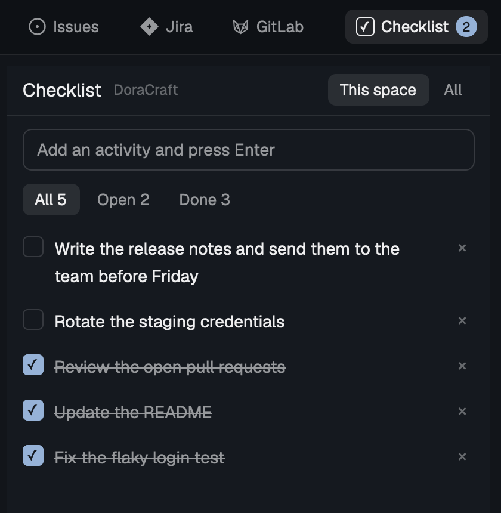

# Checklist

Um checklist de atividades para o Herdr: um painel lateral, aberto por um botão na barra de abas, onde se anota o que fazer e se vai marcando. As atividades são de um espaço ou de todos.

## O que se vê

Segue o tema do Herdr. O **botão** fica na linha da barra de abas, depois dos outros botões de painel (Issues, Jira, GitLab): 26 px de altura, caixa de seleção desenhada com um ✓, o texto "Checklist" e, quando o espaço em foco tem atividades abertas, um selo redondo com o número. Fica destacado (`selected`) enquanto o painel do checklist está aberto.

O **painel** vive na pilha do painel lateral, junto com Files e Changes, no fundo `surface`:

1. Cabeçalho de 38 px: "Checklist" em semibold, o nome do espaço em foco (ou "all spaces") discreto, e à direita dois segmentos, "This space" e "All".
2. Um campo de texto de 32 px, "Add an activity and press Enter".
3. Três segmentos de filtro com contagem: "All n", "Open n", "Done n".
4. A lista, com rolagem. Cada linha tem uma caixa de 16 px, o texto (quebra em várias linhas) e um × discreto à direita. Feita: caixa preenchida com a cor de destaque e ✓, texto riscado e apagado. Em "All", o nome do espaço aparece pequeno embaixo do texto. Lista vazia mostra uma frase curta.
5. Rodapé com "n open · n done" e, havendo feitas, "Clear done".

## Como se comporta

- Enter no campo adiciona a atividade ao **espaço em foco**, limpa o campo e, se o filtro era "Done", volta para "All". Espaços em branco sobram, o texto tem no máximo 500 caracteres e texto vazio não faz nada.
- Clicar na caixa ou no texto alterna feita/aberta; o × apaga.
- Abertas primeiro, da mais antiga para a mais nova; depois as feitas, da mais recente para a mais antiga.
- "This space" filtra pelo espaço em foco; "All" mostra tudo. A escolha é lembrada (`localStorage`).
- "Clear done" pede um segundo clique ("Clear n done? Click again"); qualquer outra ação cancela. Com "This space" apaga só as feitas daquele espaço.
- Um espaço é identificado por `máquina|pasta`, não pelo nome: renomear não separa as atividades.

## Feito com

`mods/checklist/` com `main.js` (interface, GPUI), `store.js` (dados e regras, sem importar nada do Herdr) e `mod.json` com `{ "place": "none" }`, para o Herdr não acoplar o mod sozinho. O mesmo mod serve o painel e o botão (`props.view === "button"`). Nada de imagens: a caixa e o ✓ são `div` e texto.

Os dados ficam em `appHome()/data/checklist/items.json`, `{ "version": 1, "items": [{ id, text, done, space: { key, name }, createdAt, doneAt }] }`. Cada cópia do mod faz `mkdir -p` da pasta, lê o arquivo e fica em `for (;;) { await watchFolder(dir); recarrega; }`, então painel e botão acompanham qualquer mudança, até uma feita à mão.

Toda mudança é "ler agora, aplicar, gravar só se o arquivo não mudou" (`writeTextFile(path, texto, esperado)`), com até 4 tentativas sobre o conteúdo novo. Um arquivo que não é JSON válido **nunca** é sobrescrito: o painel mostra o erro.

O botão registra `checklist` na lista compartilhada `workspace.panels` (a barra de abas só reabre, por espaço, painéis que estão nela), e só faz isso quando o bloco `checklist` já está na pilha do layout.

Layout: o bloco `checklist` na pilha `panel-body` e o bloco `checklist-button` (132 px) na linha `tab-bar`, com `props: { view: "button" }`.

## Cuidados

- `herdr-app check` renderiza o mod sem props e com o estado compartilhado de verdade. Nada no `init` pode gravar estado compartilhado sem conferir antes que as props e o layout existem.
- Salvar um arquivo recarrega as cópias no lugar, **sem** repetir o `init`. Quem precisa de um `init` novo precisa que o bloco saia do layout e volte.
- O estado compartilhado (`shared.json`) é gravado com atraso: ler logo depois de `setShared` pode mostrar o valor velho.
- Não use `tasks.*` como prefixo de estado: sobraram chaves de outro mod com esse nome.
- Mods com `"place"` diferente de `"none"` são acoplados ao layout da tela na primeira vez que o Herdr vê a pasta.

## Pronto quando

- `npm test` passa: abrir, marcar, apagar, "Clear done", contagens, ordem e filtros, o `parse` rejeitando JSON quebrado, e a gravação que refaz sobre o conteúdo novo quando o arquivo mudou no meio.
- `herdr-app check mods/checklist` passa e `herdr-app status` não mostra erro.
- Com atividades de exemplo no arquivo, o painel mostra riscado, filtros, contagens e rodapé, e o botão mostra o número de abertas do espaço em foco.
- Mudar o arquivo por fora atualiza o painel e o botão sem recarregar nada.
